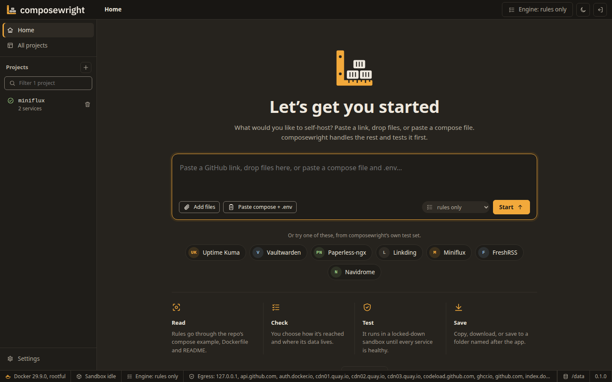
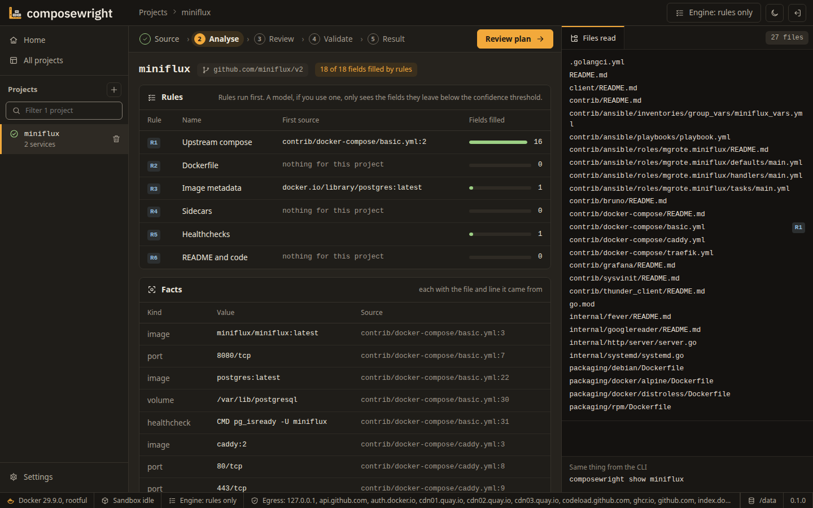
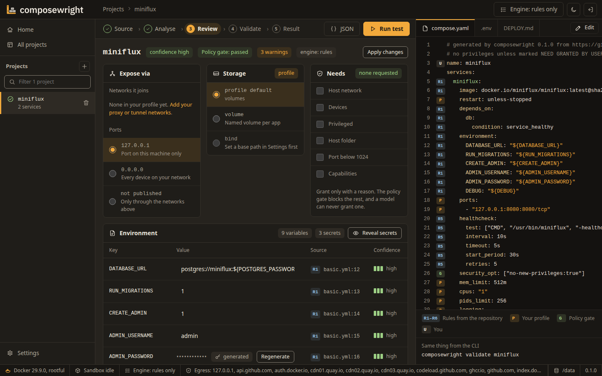
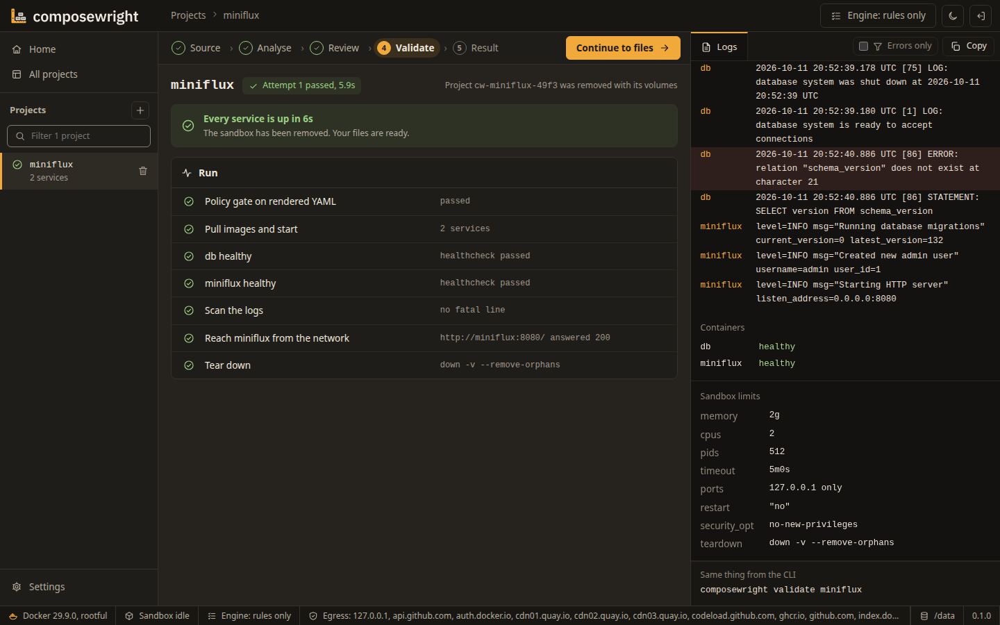
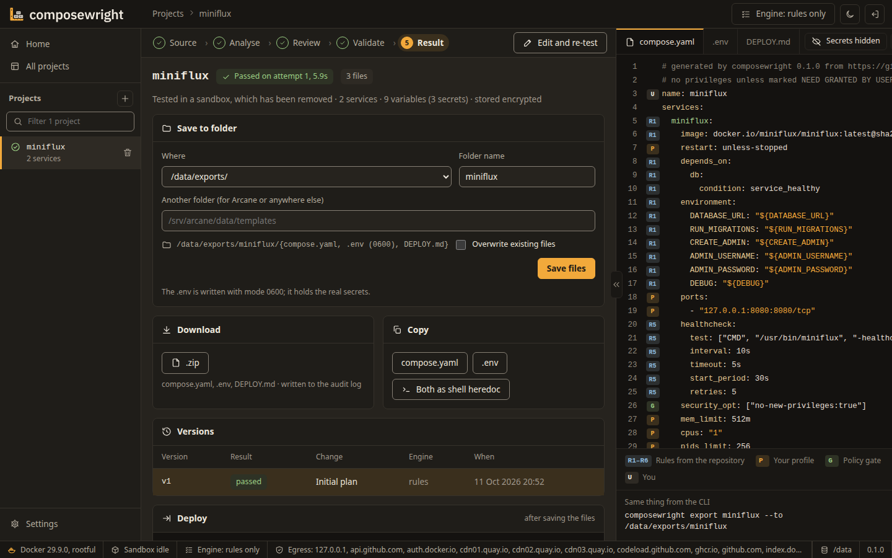

<h1>
  <picture>
    <source media="(prefers-color-scheme: dark)" srcset=".github/assets/logo-dark.svg">
    
  </picture>
</h1>

**Paste a GitHub link. Get a `compose.yaml` and a documented `.env` that actually start.**

composewright reads a repository (or a README, or a compose file you already have), works out how the app is meant to be deployed, writes a Compose file plus a `.env` with every variable explained and every secret generated, and then **proves the stack boots** by running it in an isolated, resource-capped sandbox before handing it to you. Runs as a normal user, works with a local Ollama, and never phones home.



> Status: 0.1.0, the first public release. Expect rough edges and breaking changes before 1.0; the [CHANGELOG](CHANGELOG.md) lists what each release changes.

## Quickstart — one image, one command

```sh
docker run -d --name composewright --restart unless-stopped \
  -p 127.0.0.1:8484:8484 \
  -v composewright-data:/data \
  -v /var/run/docker.sock:/var/run/docker.sock \
  --read-only --tmpfs /tmp --cap-drop ALL --cap-add CHOWN --cap-add SETGID --cap-add SETUID \
  --security-opt no-new-privileges \
  ghcr.io/aiulian25/composewright:0.1.0
```

Open **http://127.0.0.1:8484**, enter the setup key from the container's log (`docker logs composewright`, the line starting `setup key:`), set an admin password, and choose a model:

- **Local (recommended):** Ollama at `http://127.0.0.1:11434` with a coding model such as `qwen2.5-coder:14b`. Nothing leaves your machine.
- **Cloud:** paste an Anthropic or OpenAI-compatible API key. The key is stored encrypted; README content is sent to that provider, your secrets never are.

That is the whole install. The image contains everything it needs: the app, the web UI, its database, and the `docker compose` tooling it uses to validate stacks. No sidecars, no second container. It starts as root only to make its data folder its own and join the Docker socket's group, then runs as an unprivileged user with no capabilities, read-only, writing only to its data folder and a `/tmp` in memory. The Docker socket line is required: composewright tests every stack with your Docker.

### Prefer a compose file?

The same as one service, also in [`deploy/composewright.yaml`](deploy/composewright.yaml). Save it as `compose.yaml` in a folder of its own and start it with `docker compose up -d`:

```yaml
services:
  composewright:
    image: ghcr.io/aiulian25/composewright:0.1.0    # add @sha256:… from the release notes to pin these exact bytes
    container_name: composewright
    restart: unless-stopped
    ports:
      - "127.0.0.1:8484:8484"                     # this machine only; put a reverse proxy in front for LAN or TLS
    volumes:
      - composewright-data:/data                    # config, database, master key and projects; a host folder works too
      - /var/run/docker.sock:/var/run/docker.sock   # required: composewright tests stacks with your Docker
    read_only: true                                 # it writes only to /data and the /tmp below
    tmpfs: [/tmp]
    cap_drop: [ALL]
    cap_add: [CHOWN, SETGID, SETUID]                # used once at start to make /data its own and join the socket's group, then it runs as uid 65532 with none
    security_opt: ["no-new-privileges:true"]
volumes:
  composewright-data: {}
```

A folder on the host works as well as the volume, for example `- /srv/composewright:/data`: on the first start composewright makes a new or empty folder its own (uid 65532, mode 700). It never takes over a folder that already holds someone else's files.

### Running on rootless Docker

The same command with your rootless daemon's socket. Inside a rootless daemon, root is your own unprivileged user, so composewright stays root there and its data stays yours:

```sh
docker run -d --name composewright --restart unless-stopped \
  -p 127.0.0.1:8484:8484 \
  -v composewright-data:/data \
  -v "$XDG_RUNTIME_DIR/docker.sock:/var/run/docker.sock" \
  --read-only --tmpfs /tmp --cap-drop ALL --cap-add CHOWN --cap-add SETGID --cap-add SETUID \
  --security-opt no-new-privileges \
  ghcr.io/aiulian25/composewright:0.1.0
```

`composewright doctor --setup-rootless` prints the steps for the host.

### Synology (DSM 7.2+)

Container Manager → Project → paste the compose file above. composewright joins the group of `/var/run/docker.sock` by itself.

## Using it

1. **Source** — drop files (README, compose, `.env`, Dockerfile), paste a repository URL, or paste a compose file and `.env` you already have.
2. **Analyse** — the repo is fetched as a tarball through the host's API (no `git clone`, no hooks); environment variables, images, ports and volumes are extracted with their file and line; rules turn that into a plan, and a model fills what they leave open only if you choose one.
3. **Review** — every variable shows where it came from; secrets are generated for you; anything that needs host networking, devices, privileged mode or the Docker socket is a request *you* grant, never a default; the test runs without the Docker socket even once you grant it. You can edit compose.yaml yourself before the test; the policy gate checks your version too.
4. **Validate** — the stack runs in a throw-away Compose project with memory, CPU and pid limits, ports bound to loopback, and `restart: "no"` so crash loops surface. Health checks and logs decide pass or fail; with a model, failures are repaired and retried up to three times.
5. **Result** — copy the files, download them as a zip, save them to a folder named after the container (rename it if you like), or push them straight into Arcane's templates or projects folder. Delete or start over from the same screen.

<table>
  <tr>
    <td><br><b>Analyse</b>: every fact with its file and line</td>
    <td><br><b>Review</b>: sources, hidden secrets, your grants</td>
  </tr>
  <tr>
    <td><br><b>Validate</b>: the stack proven in a sandbox</td>
    <td><br><b>Result</b>: save, download or copy</td>
  </tr>
</table>

Everything above also works from the CLI:

```sh
composewright gen https://github.com/miniflux/v2
composewright show miniflux
composewright export miniflux --to ./miniflux
```

## Ways to run it

| How | Start it with | Notes |
|---|---|---|
| `docker run` | the quickstart above | A named volume, or any host folder |
| Compose | `deploy/composewright.yaml` | The same as one service |
| Hardened compose | `deploy/composewright.hardened.yaml` | A socket proxy on an internal network, read-only containers |
| Rootless Docker | the command above | Your own daemon; the data stays yours |
| Synology DSM 7.2+ | Container Manager → Project | `deploy/composewright.yaml` |

The container image is the only distribution. To work on composewright itself, see `CONTRIBUTING.md`.

## Security posture

- **Non-root once started.** The container starts as root only to make its data folder its own and join the Docker socket's group, then runs as uid 65532 with no capabilities, needing only the socket and its data folder; a rootless Docker daemon is the recommended sandbox and `doctor` tells you how to set one up.
- **The model never writes YAML.** It returns a restricted plan that cannot express `privileged`, host mounts or `build:`; composewright's own code renders the Compose file and enforces a policy gate independent of the model.
- **Nothing runs without you.** You approve the plan before validation; privilege requests are explicit checkboxes.
- **Secrets stay encrypted.** `.env` values are stored with authenticated encryption under a key that lives outside the database; they are written to disk only for the seconds a run needs them and only in saved exports you ask for.
- **No phone-home.** No telemetry, no update checks, no CDN assets, no web fonts. Outbound connections go only to the model endpoint you configured, the code host you asked for, and container registries for image checks — and a build-time check enforces that.

The Docker socket is root-equivalent on the host; the UI is therefore bound to `127.0.0.1` by default and always requires a login. An optional hardened compose file with a socket proxy is `deploy/composewright.hardened.yaml`; its comments explain the setup.

## What it is not

Not a PaaS, not a reverse proxy, not an app store, and it does not build images from source. When a stack passes, export it to whatever you already run — Arcane, Dockge, Portainer, Dokploy, or plain `docker compose up -d`.

## Development

Go 1.26+, `CGO_ENABLED=0`. `make lint test build`. See [CONTRIBUTING.md](CONTRIBUTING.md), and [SECURITY.md](SECURITY.md) for disclosure.

## License

MIT. See [LICENSE](LICENSE) and [THIRD_PARTY_LICENSES.md](THIRD_PARTY_LICENSES.md).
